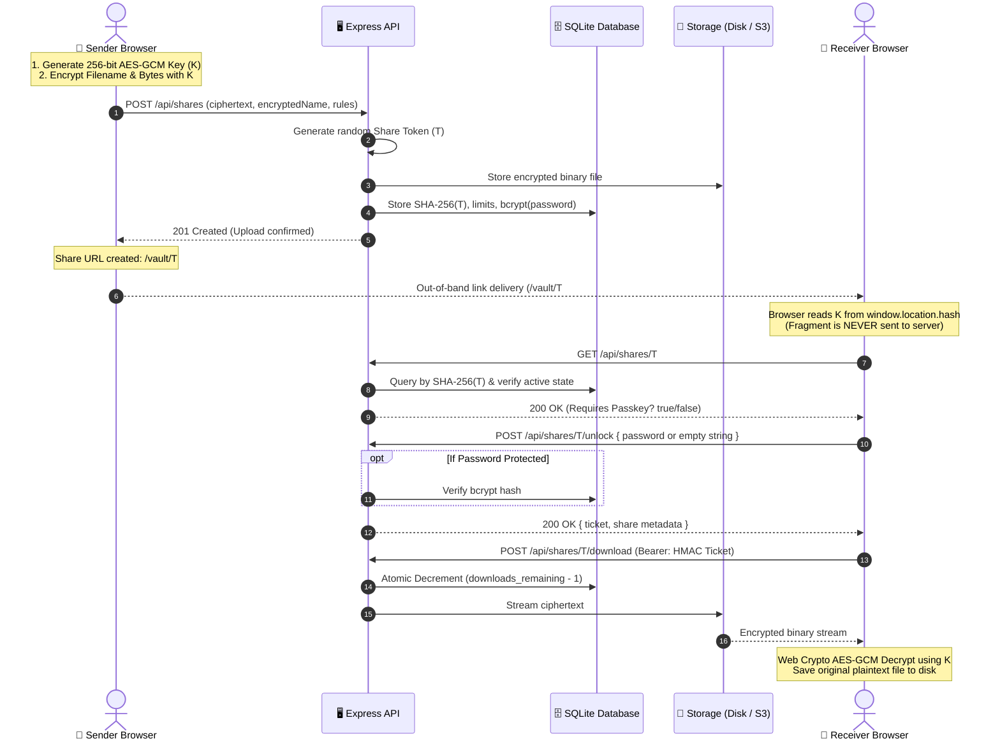
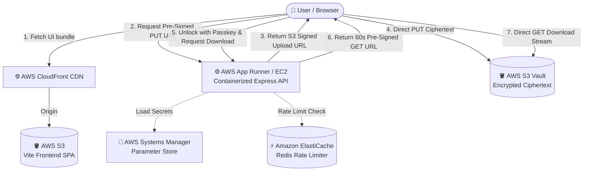

<div align="center">

# 🕊️ Peigon

### **Zero-Trust, Ephemeral Digital File Transfer System**
*Engineered for secure, self-destructing, client-side encrypted file transfers.*

[](https://aws.amazon.com/)
[](https://nodejs.org/)
[](https://react.dev/)
[](https://vitejs.dev/)
[](https://tailwindcss.com/)
[](https://www.sqlite.org/)
[](https://aws.amazon.com/)

<p align="center">
  <a href="#-project-overview">Overview</a> •
  <a href="#-core-features--deliverables">Features</a> •
  <a href="#-zero-trust-cryptographic-architecture">Architecture</a> •
  <a href="#-tech-stack">Tech Stack</a> •
  <a href="#-team-kernel-paradox--task-division">Team & Tasks</a> •
  <a href="#-quick-start">Quick Start</a> •
  <a href="#-api-specification">API Spec</a> •
  <a href="#-aws-cloud-milestone-architecture">AWS Milestone</a> •
  <a href="#-security--threat-model">Security</a>
</p>

---

</div>

## 📌 Project Overview & Problem Statement

Modern collaboration requires sharing sensitive documents—credentials, server keys, medical records, legal contracts, and confidential financial audits. However, traditional file-sharing platforms (Google Drive, Dropbox, email attachments) create severe security and privacy liabilities:
1. **Permanent Digital Footprints:** Files remain indefinitely in cloud storage, susceptible to server-side breaches, metadata scraping, and unauthorized insider access.
2. **Lack of True Zero-Knowledge:** Central servers hold the plain text or manage the decryption keys, defeating the principle of zero-trust.
3. **Uncontrolled Dissemination:** Links can be scraped, indexed, or shared repeatedly without strict view quotas or hard mathematical self-destruction.

### 💡 The Solution: Peigon
**Peigon** is an ephemeral file transfer platform (analogous to *Firefox Send* or *SendSafely*). The current browser app encrypts uploads end-to-end. The retained legacy API accepts unencrypted uploads for backward compatibility. Current browser transfers are:
- **Client-Side Encrypted:** Encrypted with **AES-256-GCM** inside the sender's browser *before* any bytes touch the wire.
- **Zero-Knowledge by Design:** The cryptographic decryption key is embedded solely in the URL `#fragment` (RFC 3986), which browsers never transmit in HTTP requests. The server stores only raw ciphertext and can never inspect file contents or original filenames.
- **Strictly Self-Destructing:** Files automatically vaporize based on granular rules—either reaching a strict download cap (1, 3, or 10 downloads) or time-to-live expiration (10 min, 1 hr, 24 hr).
- **Protected by Optional Passkeys:** Senders can gate download access behind a bcrypt-hashed passkey with automatic brute-force lockout.

---

## ✨ Core Features & Deliverables

### 1. 🚀 Secure Upload Portal (Sender)
- **Drag-and-Drop Staging Zone:** Streamlined file drop zone supporting single files or multi-file selections (up to **100 MB** total).
- **Client-Side Archive Engine:** Multiple files are bundled into a ZIP archive directly in client memory via `fflate` prior to encryption.
- **Granular Expiry Rules:**
  - **Time Caps:** `10 minutes` (quick exchange), `1 hour` (standard meeting), `24 hours` (asynchronous drop).
  - **Download Limits:** `1 download` (burn-after-reading), `3 downloads` (small team), or `10 downloads` (workgroup).
- **Passkey Gate (Optional):** Custom password protection hashed on the server using **bcrypt**; required before protected share metadata or download tickets are returned.
- **Live Progress & Telemetry:** Real-time upload percentage, encrypted payload size calculations, and instant generation of the zero-trust share link.

### 2. 🔐 Access & Decryption Portal (Receiver)
- **Non-Guessable Vault URLs:** Links route to `/vault/:shareToken#<base64-encryption-key>`.
- **Zero-Leak Passkey Verification:** Metadata (file size, name, download count) is completely withheld until the passkey is validated.
- **Ephemeral Download Tickets:** A successful password check issues a short-lived (60-second) HMAC-SHA256 signed bearer ticket. The current browser app does not resend passkeys during downloads; legacy API clients can still use the original request format.
- **In-Browser Decryption:** Fetches the encrypted file and decrypts it using the browser's native **Web Crypto API**, restoring the encrypted original filename.

### 3. ⚙️ Backend Orchestrator & Expiry Engine
- **Token Enumeration Prevention:** Raw share tokens are never stored. The server hashes tokens using **SHA-256 digests**, making database compromise useless for constructing valid download URLs.
- **Atomic Concurrency Control:** SQLite write-ahead logging (WAL) executes conditional atomic decrements (`UPDATE shares SET downloads_remaining = downloads_remaining - 1 WHERE ...`). Concurrent requests cannot exceed the download quota.
- **Automated Garbage Collection Worker:** A recurring cron job running every **5 minutes** permanently wipes expired and exhausted binary files from disk/storage and marks records as deleted.
- **Unified 404 Responses:** Invalid, expired, exhausted, and non-existent tokens return identical 404 responses to eliminate oracle enumeration attacks.

### 4. ☁️ AWS Cloud Milestone (Planned)

This architecture is a future milestone; the current app uses local SQLite and filesystem storage and does not include AWS integrations.

- **Direct-to-S3 Uploads:** Pre-signed S3 `PUT` URLs eliminate web-server memory and network bottlenecks.
- **Ephemeral S3 Downloads:** Pre-signed S3 `GET` URLs (valid for 60 seconds) generated dynamically upon ticket validation.
- **Edge Acceleration:** Static Vite bundle distributed through **AWS CloudFront** with **AWS S3** origin.
- **Containerized Backend:** Dockerized Node.js service designed for **AWS App Runner** or **AWS EC2**.

---

## 🔒 Zero-Trust Cryptographic Architecture



### Why the URL Fragment (`#`) Guarantees Zero-Trust
According to **RFC 3986 §3.5**, uniform resource identifier (URI) fragments are evaluated strictly on the client agent. When a user navigates to:
```
https://peigon.example.com/vault/<43-character-token>#<base64url-key>
                                     Share Token      AES-256 Key (Local Only)
```
1. The **Share Token** is sent in the HTTP GET path to identify the database record.
2. The **AES-256 Key** stays inside the browser's JavaScript execution runtime. It is **never sent** in HTTP request headers or request bodies.
3. A database or ciphertext storage leak does not reveal file contents without the recipient's private URL fragment. This applies to transfers made with the current browser app; legacy API uploads are unencrypted.

---


## 🛠️ Tech Stack & Tooling

| Domain | Technology / Library | Purpose in Peigon |
| :--- | :--- | :--- |
| **Frontend Framework** | **React 19** | Dynamic, reactive UI for file staging and download unlock |
| **Build Tool** | **Vite 8** | High-performance bundling, development HMR, and static assets |
| **Styling** | **Tailwind CSS v4** | Modern, responsive, utility-first design system |
| **Icons** | **Lucide React** | Intuitive visual indicators for state, security, and actions |
| **Client Compression** | **fflate** | Client-side ZIP creation for multi-file transfers |
| **Client Encryption** | **Web Crypto API (SubtleCrypto)** | Native 256-bit AES-GCM encryption with 12-byte random IVs |
| **Backend Runtime** | **Node.js 22 (LTS)** | High-throughput asynchronous server runtime |
| **Web Server** | **Express 5** | RESTful routing, streaming attachments, and middleware |
| **Data Persistence** | **SQLite (`better-sqlite3`)** | Ultra-fast local database in WAL mode with atomic transactions |
| **Validation** | **Zod 4** | Strict runtime schema validation for uploads and payloads |
| **Security & Hashing** | **bcryptjs + Node.js crypto** | Passkey salting/hashing, SHA-256 token digests, HMAC-SHA256 tickets |
| **Scheduler** | **node-cron** | 5-minute interval automated disk cleanup of expired shares |
| **Testing** | **Vitest 5 + Supertest** | Unit, integration, security, and concurrency race-condition tests |
| **Containerization** | **Docker (Alpine Multi-Stage)** | Lightweight, hardened production container running as `node` user |
| **Planned Cloud Services** | **AWS S3, CloudFront, App Runner** | Future production architecture for direct-to-S3 I/O |

---

## 📁 Repository Structure

```text
Peigon/
├── .github/
│   └── workflows/
│       └── ci.yml               # Automated CI pipeline (lint, format, test, build)
├── client/                      # Frontend client application
│   ├── src/
│   │   ├── main.jsx             # React 19 UI + Web Crypto AES-GCM engine
│   │   └── style.css            # Tailwind CSS styling and theme definitions
│   ├── index.html               # Frontend HTML root
│   └── dist/                    # Compiled production assets
├── data/                        # Persistent database directory (mounted in Docker)
│   └── shares.sqlite            # SQLite database with WAL journals
├── src/                         # Modular backend source code
│   ├── config/
│   │   └── env.js               # Environment parsing and validation
│   ├── controllers/
│   │   └── shareController.js   # HTTP controller handlers
│   ├── middleware/
│   │   └── securityHeaders.js   # Helmet, CORS, and cache controls
│   ├── repositories/
│   │   └── shareRepository.js   # Data access abstraction
│   ├── routes/
│   │   └── shareRoutes.js       # Express route declarations
│   ├── services/
│   │   ├── cleanupService.js    # Automated cron garbage collector
│   │   └── securityService.js   # HMAC tickets, SHA-256 tokens, rate-limiters
│   ├── validation/
│   │   └── shareSchemas.js      # Zod validation schemas
│   └── database.js              # SQLite connection, migrations, and atomic queries
├── tests/
│   └── server.test.js           # Comprehensive Vitest integration & concurrency test suite
├── uploads/                     # Local encrypted file repository
├── .env.example                 # Environment variables blueprint
├── docker-compose.yml           # Container orchestration with persistent volumes
├── Dockerfile                   # Multi-stage production container build
├── package.json                 # Project dependencies and script runner
├── server.js                    # Express application entrypoint
└── vite.config.mjs              # Vite configuration
```

---

## 🚀 Quick Start & Local Development

### Prerequisites
- **Node.js:** v22.12.0 or higher
- **npm:** v10 or higher
- **Docker & Docker Compose** *(optional for container run)*

### 1. Clone & Install Dependencies
```bash
git clone https://github.com/your-username/peigon.git
cd peigon
npm install
```

### 2. Configure Environment Variables
Copy the example environment configuration:
```bash
# On Linux / macOS:
cp .env.example .env

# On Windows (PowerShell):
Copy-Item .env.example .env
```

| Variable | Description | Default |
| :--- | :--- | :--- |
| `PORT` | Local port for Express API server | `3000` |
| `TICKET_SECRET` | 32+ character random secret used for signing HMAC tickets | Auto-generated in dev |
| `STORAGE_PATH` | Local directory for database and encrypted files | `.` (project root) |
| `FRONTEND_URL` | Comma-separated allowed origins for CORS (leave empty for same-origin) | `""` |
| `TRUST_PROXY` | Set `true` if behind reverse proxy/load balancer (e.g. CloudFront/Render) | `false` |
| `VITE_API_URL` | Base API URL for frontend (leave blank when served from Express) | `""` |

### 3. Run Development Servers
Launch both Vite frontend and Express server concurrently with hot reload:
```bash
npm run dev
```
- **Web Portal:** Open `http://localhost:5173` (Vite) or `http://localhost:3000` (Express)
- **API Health Check:** `http://localhost:3000/healthz`

---

## 🐳 Running with Docker

Peigon includes a hardened, multi-stage `Dockerfile` and `docker-compose.yml` configured with named persistent volumes and unprivileged user execution (`node`).

```bash
# Build and run the containerized stack
docker compose up --build -d

# Check container status and health
docker compose ps

# View real-time logs
docker compose logs -f
```

Access the application at `http://localhost:3000`. Encrypted files and the SQLite WAL database are persisted across container restarts in the `vaultdrop-data` and `vaultdrop-uploads` Docker volumes.

---

## 📡 API Specification

Control endpoints return JSON. Download endpoints stream the encrypted file bytes.

### 1. Create a Secure Share
- **Endpoint:** `POST /api/shares`
- **Content-Type:** `multipart/form-data`
- **Payload:**
  - `file`: File bytes (max 100 MB). The current browser app encrypts these bytes before upload.
  - `encryptedName`: Base64URL encoded encrypted original filename (sent by the current browser app).
  - `expiryMinutes`: `10` \| `60` \| `1440` (minutes).
  - `maxDownloads`: `1` \| `3` \| `10`.
  - `password`: *(Optional)* Client-defined passkey string.

**Response (`201 Created`):**
```json
{
  "url": "https://peigon.example.com/vault/<43-character-token>",
  "share": {
    "fileName": null,
    "encryptedName": "<base64url-ciphertext>",
    "fileSize": 1459228,
    "expiresAt": "2026-11-02T14:15:00.000Z",
    "downloadsRemaining": 3,
    "passwordRequired": false
  }
}
```

The `encryptedName` field is optional for compatibility with older clients. Omitting it creates a legacy, unencrypted share.

---

### 2. Inspect Share State
- **Endpoint:** `GET /api/shares/:token`

**Response (`200 OK` - When Passkey is required):**
```json
{
  "passwordRequired": true
}
```

**Response (`200 OK` - When No Passkey Is Configured):**
```json
{
  "passwordRequired": false,
  "share": {
    "fileName": null,
    "encryptedName": "<base64url-ciphertext>",
    "fileSize": 1459228,
    "expiresAt": "2026-11-02T14:15:00.000Z",
    "downloadsRemaining": 3,
    "passwordRequired": false
  }
}
```

---

### 3. Unlock Protected Share
- **Endpoint:** `POST /api/shares/:token/unlock`
- **Content-Type:** `application/json`
- **Body:** `{ "password": "user-passkey" }`

The current browser client calls this endpoint for every share to obtain its download ticket. For a share without a passkey, send an empty password.

**Response (`200 OK`):**
```json
{
  "share": {
    "fileName": null,
    "encryptedName": "<base64url-ciphertext>",
    "fileSize": 1459228,
    "expiresAt": "2026-11-02T14:15:00.000Z",
    "downloadsRemaining": 3,
    "passwordRequired": true
  },
  "ticket": "<payload>.<signature>"
}
```
> [!NOTE]
> The returned `ticket` is a cryptographically signed HMAC token valid for **60 seconds**.

---

### 4. Download Payload
- **Endpoint:** `POST /api/shares/:token/download`
- **Headers:** `Authorization: Bearer <ticket>` (or legacy JSON body)
- **Response (`200 OK`):** Streams the file with `Cache-Control: no-store` and `X-Content-Type-Options: nosniff`.
- **Side Effect:** Atomically decrements `downloads_remaining`. When the final allowed download completes, the server deletes the file and marks the record deleted.
- **Legacy behavior:** Clients uploading without `encryptedName` may provide the passkey in the JSON request body instead of a ticket. Those legacy shares are not end-to-end encrypted.

---

### 5. Health Check
- **Endpoint:** `GET /healthz`
- **Response (`200 OK`):**
```json
{
  "status": "ok"
}
```

---

## ☁️ AWS Cloud Milestone Architecture

For a future high-scale production deployment, Peigon could transition to AWS cloud services:



### AWS Production Implementation Blueprint:
1. **Frontend Hosting (S3 + CloudFront):**
   - Static assets built via `npm run build` are uploaded to an Amazon S3 bucket configured for static web hosting.
   - An **AWS CloudFront** distribution provides SSL termination, HTTP/3, and low-latency edge delivery worldwide.
2. **Direct-to-S3 Uploads (Eliminating Server Overhead):**
   - The Express backend uses `@aws-sdk/s3-request-presigner` to issue an S3 `PutObjectCommand` Pre-signed URL.
   - The client sends the encrypted file directly to S3 via HTTP `PUT`. The Node.js server does not handle the binary payload, which can reduce server bandwidth and improve upload capacity.
3. **Ephemeral S3 Pre-Signed Downloads:**
   - Once a recipient validates their passkey, the API issues a temporary S3 `GetObjectCommand` pre-signed link valid for exactly 60 seconds.
4. **Secrets & Security:**
   - Master signing keys (`TICKET_SECRET`) and configuration parameters are loaded securely at startup via **AWS Systems Manager (SSM) Parameter Store**.
5. **Horizontal Rate Limiting:**
   - In-memory rate limiting transitions to **Amazon ElastiCache (Redis)** to synchronize IP/token lockout states across multiple container instances.

---

## 🛡️ Security & Threat Model

| Threat / Attack Vector | Mitigation in Peigon |
| :--- | :--- |
| **Server-Side Data Breach** | **Browser AES-GCM:** Current browser-app transfers encrypt file contents and names before upload. Decryption keys stay in the URL fragment (`#`) and are not sent to the server. Legacy API uploads without `encryptedName` are unencrypted. |
| **Database Compromise** | **Hashed Token Digests:** The database stores `SHA-256(token)`. A stolen database cannot be used to deduce share URLs or download files. |
| **Passkey Brute-Forcing** | **Rate Limiting & Lockout:** Bcrypt hashes passkeys. Client IPs and tokens receive a **15-minute lockout** after 5 failed attempts. |
| **Race Conditions on Download Limit** | **Atomic SQL Decrements:** Download counts are decremented within atomic transactions before streaming begins. Concurrent requests cannot exceed download limits. |
| **Link Scraping & Crawlers** | **Cache and Referrer Controls:** Responses use `Cache-Control: no-store` and `Referrer-Policy: no-referrer`. |
| **Orchestrated ID Enumeration** | **Uniform 404 Behavior:** Invalid tokens, expired tokens, exhausted shares, and deleted links all return identical HTTP 404 responses. |
| **MIME Sniffing & XSS** | **Security Headers and Filenames:** `Helmet` applies `X-Content-Type-Options: nosniff`; legacy filenames are sanitized and downloads use attachment disposition. |

---

## 🧪 Testing & Quality Assurance

Peigon includes a rigorous test suite covering edge cases, crypto validation, and high-concurrency race condition testing.

```bash
# Run complete test suite via Vitest
npm test

# Run ESLint validation
npm run lint

# Check code formatting with Prettier
npm run format:check

# Test production build bundle
npm run build
```

### Verified Test Cases:
- ✔️ **Token Hashing & Digest Isolation:** Validates raw tokens are never recorded in database tables.
- ✔️ **Expiry Enforcement:** Verifies instant 404 cutoff when time expires.
- ✔️ **Passkey Gating:** Confirms metadata is concealed until a valid passkey unlock occurs.
- ✔️ **Brute-Force Throttling:** Asserts a 15-minute lock triggers on the 5th incorrect password attempt.
- ✔️ **Concurrency Race Test:** Simulates **10 simultaneous parallel requests** against a share configured for 3 downloads; strictly verifies that exactly 3 succeed and 7 are rejected.

---

## 📜 License

This repository does not currently contain a `LICENSE` file. Choose and add a license before redistributing the project.

---

<div align="center">

Developed with ❤️ by **Team KERNEL PARADOX**  
*Garvit Lalwani • Naman • Piyush Sharma • Karan Bhatia*  
**AWS Student Builder Club**

</div>
